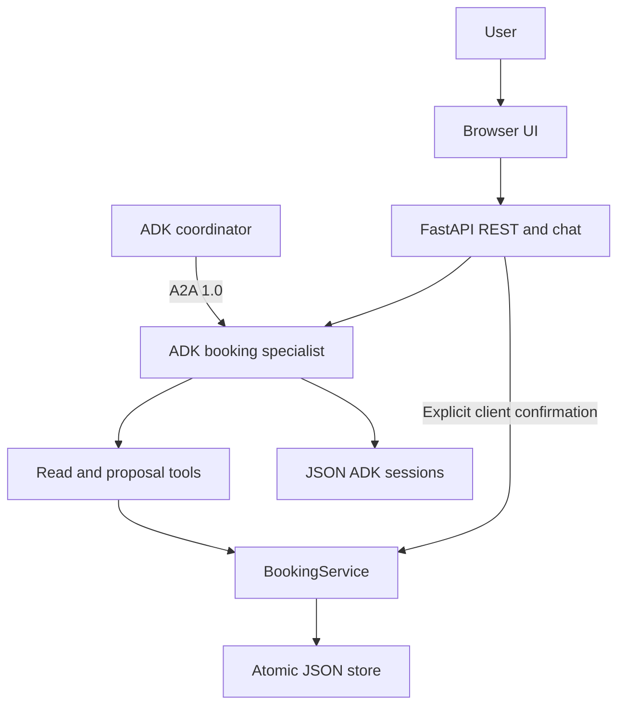

# Architecture

## Request paths

`booking_agent/agent.py` builds the specialist with GPT-5.2 via `LiteLlm`. Tools are Python functions whose schemas are inferred by ADK. `coordinator/agent.py` wraps a `RemoteA2aAgent` in `AgentTool`; this is a real transport boundary, covered by an offline integration test.

`server.py` constructs exactly one domain service backed by JSON and shares it between REST and the specialist. A2A is mounted on the same application; its lifespan is explicitly entered so discovery/RPC routes initialize. The committed Agent Card is generated from the same agent definitions, never maintained as an incompatible handwritten schema.

## Mutation state machine

1. Agent or client submits a complete create/update/delete proposal.
2. Service validates schema, business hours, ownership, version and slot conflicts.
3. It atomically saves the proposal. Older pending proposals in that conversation are superseded.
4. Client renders the exact proposal and obtains human approval.
5. Confirmation binds to the immutable proposal ID and its stored payload.
6. In one transaction, the service checks expiry, latest booking version and availability, then writes the booking and marks the proposal committed.
7. A duplicate confirmation returns the original result without a second mutation.

**There is no commit/delete/write tool exposed to the LLM.** Only the confirmation REST route invokes `BookingService.confirm`. Natural-language “yes” and remote-agent text are not trusted authorization signals. Changed details need a replacement proposal. Cancellation removes the active record, but proposal history can still contain earlier details; deletion is not a GDPR erasure workflow.

## Storage and concurrency

- `runtime/bookings.json`: versioned document containing `bookings`, `proposals`, and compact audit records.
- `runtime/sessions.json`: ADK sessions, events, application state and user state.
- Cross-process `FileLock` protects each transaction. The writer flushes/fsyncs a temporary file, then atomically replaces the destination. Exceptions before replacement preserve the old document.
- Overlap uses half-open UTC intervals, allowing adjacent appointments. Business hours use the configured IANA timezone.
- Updates and deletes require `expected_version`; a losing concurrent change cannot overwrite a winner.
- Session append checks its stored revision timestamp to reject stale updates. HTTP chat serializes a session within the single server process. Keep one Uvicorn worker.
- Whole-document rewrites and in-memory lock maps are suitable for a small local demo. History/proposal retention and distributed execution are future work.
- SQLite code is a dormant adapter with parity tests. Runtime code never imports or selects it.

## Identity and trust

The runnable demo fixes ownership to `demo-user`. Domain methods accept explicit owners and are tested for isolation, but transports do not establish distinct end-user identities yet. A shared bearer token is optional ingress protection, not tenant authorization. Add authenticated identity propagation before multi-user deployment.

No tools execute code, SQL, arbitrary paths or external URLs. Customer text is data. Booking facts come from tools; success requires a committed service result. Model output can still be misleading; the UI's stored records are authoritative.

## Recovery and errors

JSON session history survives restarts. A2A task lifecycle state is currently in memory, so in-flight task recovery is not supported. REST chat has a 120-second deadline and a 12-model-call cap. A2A coordinator transport has a 60-second timeout. Domain errors are machine-readable (`conflict`, `stale_version`, `expired`, `not_found`, etc.). No silent JSON reset occurs on corruption.

## Evaluation boundaries

Deterministic tests validate domain behavior. Scripted models exercise framework/protocol wiring. Live ADK tests use a fixed clock and fresh store per case, check expected tool paths where defined, and assert stored bookings did not change without confirmation. Google-backed judges assess conversational quality separately. These are different forms of evidence and must not be described interchangeably.
